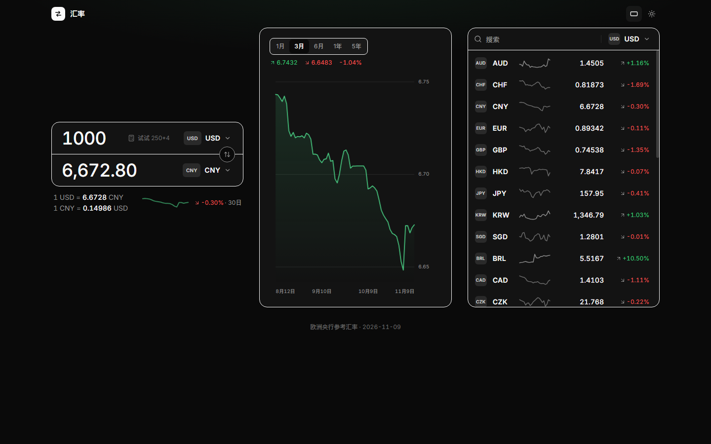
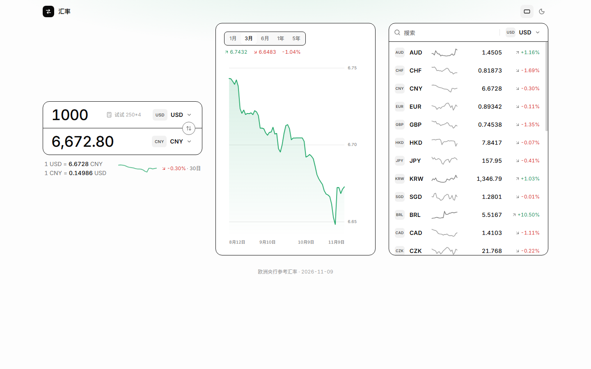
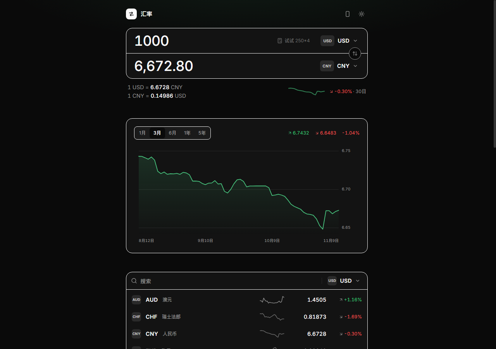
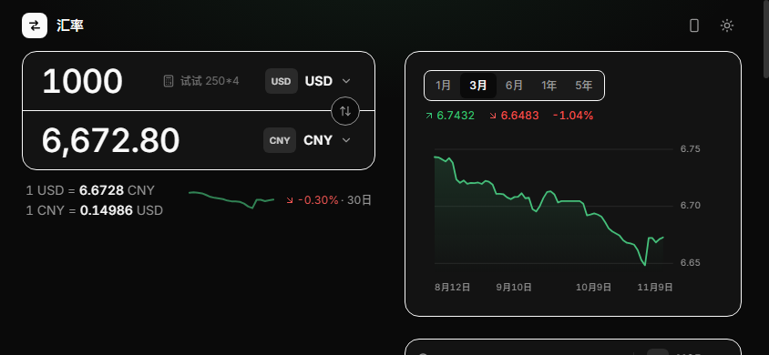

# 汇率 · huilv

汇率换算、走势图与行情一览。单一 Go 二进制，前端全部内嵌，下载即用，离线也能跑。

<p>
  
  
</p>
<p>
  
  
</p>

## 功能

- **换算** — 双向输入，改任一侧另一侧即时联动；金额栏支持算术表达式（`1200*4+50`、`(45-3)/2`），输入时实时显示求值
- **29 种货币** — 欧洲央行参考汇率全集，含中文币种名与符号；搜索支持代码 / 中文 / 英文（按 `/` 聚焦）
- **趋势图** — 1月 / 3月 / 6月 / 1年 / 5年，悬停十字线显示日期与汇率，区间最高 / 最低 / 涨跌
- **行情面板** — 全部货币相对基准的汇率、30 日走势与涨跌，点击行设为目标货币
- **手动布局** — 手机横屏自动切换双栏（左换算、右趋势 + 表格），也可用头部按钮手动强制
- **细节** — 深浅色主题（无闪烁）、键盘可导航、状态持久化、货币选择即搜即选

## 快速开始

从 [Releases](https://github.com/jiqing112/huilv/releases) 下载对应平台的压缩包，解压后直接运行：

```sh
./huilv                     # 默认监听 http://127.0.0.1:8080
```

Windows 双击 `huilv.exe`，浏览器打开 <http://127.0.0.1:8080>。

### 从源码构建

```sh
git clone https://github.com/jiqing112/huilv.git
cd huilv/frontend && npm install && npm run build && cd ..
go build -o huilv .
```

前端构建产物通过 `go:embed` 打进二进制，产物就是一个可执行文件。

### 开发模式

```sh
go run . -addr 127.0.0.1:8080        # 终端 1：后端 + API
cd frontend && npm run dev           # 终端 2：前端 :5173，/api 自动代理
```

## 配置

| 标志 | 默认 | 说明 |
| --- | --- | --- |
| `-addr` | `:8080` | 监听地址 |
| `-data` | `./data` | SQLite 数据目录 |

URL 参数：`?theme=dark` / `?theme=light` 指定主题，`?layout=landscape` 指定横排布局（适合分享与截图）。

## 数据

来源为 [frankfurter.dev](https://frankfurter.dev)（欧洲央行参考汇率），后端每小时拉取一次最近 7 天数据（含修订），失败时继续提供旧数据。所有汇率以 USD 为基准存储于 SQLite（WAL），交叉汇率即时推导。

首次启动内置约 17 个月的真实日线数据（`internal/seeddata/rates.json`），离线也能完整使用；ECB 仅在交易日发布，周末保持周五数据。

## API

| 端点 | 说明 |
| --- | --- |
| `GET /api/currencies` | 币种元数据 |
| `GET /api/latest?base=USD` | 最新汇率（任意基准） |
| `GET /api/history?from=&to=&days=` | 货币对日线（≤1825 天） |
| `GET /api/board?base=&days=30` | 全部币种相对基准的日线序列 |
| `GET /api/status` | 数据新鲜度 |

## 技术栈

Go（标准库 `net/http` + modernc.org/sqlite，无 CGO）· Svelte 5 + Tailwind CSS v4 · 单二进制 `go:embed`
